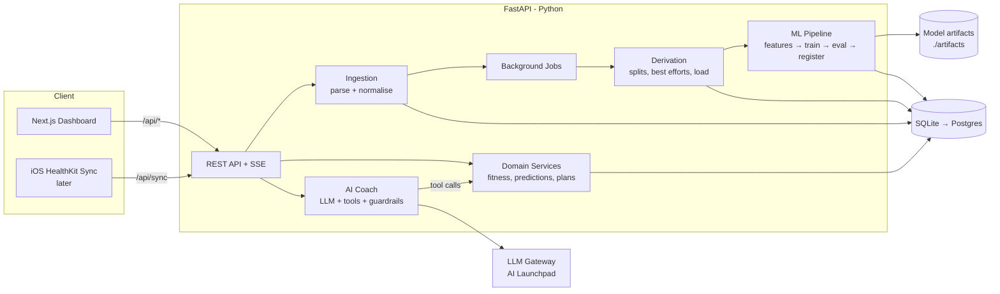
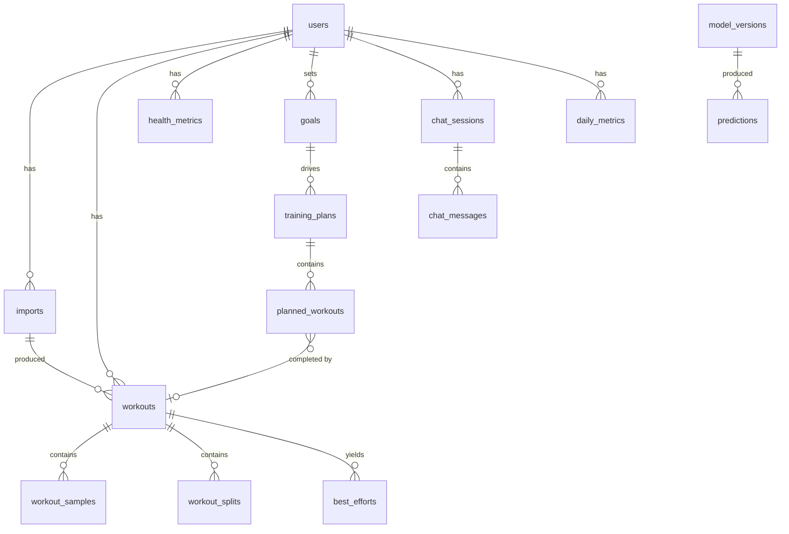

# Running Coach v2 — Design Document

> Status: **DRAFT** · Owner: Mike · Last updated: 2026-11-08

## 1. Summary

Running Coach is a personal training platform. It ingests running workouts
from Apple Health, stores them in a relational database, derives physiology
metrics, trains personalised ML models to predict race times and fitness,
generates adaptive training plans, and exposes an AI coach you can chat with.
A Next.js dashboard presents all of it.

**Guiding principles**

1. **Python owns all business logic.** Next.js is a presentation layer only. One
   source of truth for every number shown on screen.
2. **Physiology first, ML second.** Proven formulas (Daniels VDOT, Riegel,
   Banister) are the baseline. An ML model only ships if it *beats* the baseline
   on held-out data.
3. **The LLM never invents numbers.** The coach gets facts via tool calls into
   the same service layer that powers the REST API.
4. **Single-user now, multi-user ready.** Every row carries `user_id`; auth is
   stubbed until we need it.
5. **Boring tech, small modules.** No file over ~600 lines; no infra we don't
   need yet (no Kafka, no Kubernetes, no MLflow on day one).

## 2. Goals & Non-Goals

### Goals

| # | Goal | Measured by |
|---|------|-------------|
| G1 | Import Apple Health data (export ZIP, later HealthKit sync) | 1 GB export imports in < 3 min, idempotent re-imports |
| G2 | Persist workouts, samples, and health metrics | Normalised schema, migrations via Alembic |
| G3 | Predict race times (5K → Marathon) with confidence bands | MAE beats Riegel baseline in walk-forward validation |
| G4 | Track fitness (VDOT, CTL/ATL/TSB, efficiency) over time | Daily time series available via API |
| G5 | Prescribe training paces | Deterministic from current VDOT + HR zones |
| G6 | Generate adaptive training plans toward a goal race | Plans pass safety guardrails 100% of the time |
| G7 | AI coach chat grounded in the user's data | Every number cited traces to a tool call |
| G8 | Dashboard for all of the above | WCAG 2.2 AA, responsive, < 2 s initial load |

### Non-Goals (for v2)

- Strava/Garmin integrations (design the ingestion layer so they can plug in later).
- Social features, leaderboards, sharing.
- Medical diagnosis or injury treatment advice.
- Native mobile app beyond the existing HealthKit sync stub.
- Real-time live-workout tracking.

## 3. Key Constraint: Getting Data Out of Apple Health

There is **no web API for HealthKit.** Data can leave the iPhone only through:

| Path | How | Pros | Cons | Phase |
|------|-----|------|------|-------|
| **A. Health export ZIP** | Health app → Profile → *Export All Health Data* → upload `export.zip` | Zero mobile code, full history, includes GPX routes | Manual, file can be 1–5 GB | **MVP** |
| **B. iOS companion app** | Swift app reads HealthKit, POSTs batches to `/api/sync` | Automatic, incremental | Requires Xcode + Apple dev account | Later |
| C. Third-party exporters (e.g. Health Auto Export) | App pushes JSON to a webhook | No Swift code | Paid app, external dependency | Optional |

The export ZIP contains:

- `apple_health_export/export.xml` — `<Workout>`, `<Record>` (HR, VO₂max, HRV, resting HR…), `<WorkoutStatistics>`, `<WorkoutEvent>` (laps/segments)
- `apple_health_export/workout-routes/*.gpx` — GPS + elevation per workout

Both A and B feed the **same normaliser**, so downstream code never cares
where the data came from (Open/Closed principle).

## 4. Architecture



### Layering (backend)

```
api/        → HTTP only: routing, request/response schemas, auth. No logic.
services/   → Use cases. Orchestrates repositories + domain + ml. REST AND the LLM tools call this.
domain/     → Pure functions: VDOT, Riegel, Banister, pace zones, plan rules. No I/O. 100% unit-testable.
ml/         → Feature building, training, evaluation, model registry, inference.
ingestion/  → Parsers (export XML, GPX, HealthKit JSON) → normalised DTOs.
db/         → SQLAlchemy models, repositories, Alembic migrations.
coach/      → LLM client abstraction, tool registry, prompts, guardrails, chat memory.
jobs/       → Background task runner + pipeline orchestration.
```

Dependencies point **inward only**: `api → services → (domain, ml, db)`.
`domain/` imports nothing from the project. This is the main thing v1 got
wrong (533-line `main.py` mixing routing, SQL, and ML).

## 5. Tech Stack

### Backend

| Concern | Choice | Why |
|---------|--------|-----|
| Language | Python 3.12 | Wide wheel support (numpy/xgboost); 3.15 is too new |
| Package mgmt | `uv` + `pyproject.toml` + `uv.lock` | Fast, reproducible, Walmart standard |
| Web | FastAPI + Pydantic v2 | Typed, OpenAPI for free → generates frontend types |
| ORM / migrations | SQLAlchemy 2.0 + Alembic | Same code on SQLite and Postgres |
| Database | **SQLite (MVP) → Postgres** | Zero-ops locally; swap via `DATABASE_URL` |
| XML parsing | `lxml.etree.iterparse` (streaming) | Exports are GBs; never load into memory |
| ML | scikit-learn, XGBoost (or LightGBM), pandas | Tabular data, small n → GBMs + linear models |
| Model persistence | `joblib` artifacts + `model_versions` table | Lightweight registry; MLflow is YAGNI for now |
| Background jobs | FastAPI `BackgroundTasks` + `jobs` table | Upgrade to `arq`/Redis only when needed |
| LLM | Provider interface; default adapter = **AI Launchpad** | Swappable (Gemini/OpenAI adapters possible) |
| Testing | pytest, httpx `TestClient`, hypothesis (domain math) | |
| Lint/format/types | ruff, mypy (strict on `domain/`) | |

### Frontend

| Concern | Choice | Why |
|---------|--------|-----|
| UI library | React 19 | All pages/components are React; Next.js is built on it |
| Framework | Next.js 16 (App Router, Cache Components) + TypeScript | Requested; adds routing, SSR, API proxy, build tooling on top of React |
| Styling | Tailwind CSS 4 | Fast, consistent |
| Components | Small hand-rolled set (`components/ui.tsx`) | Few primitives needed so far; adopt shadcn/ui (Radix) when we need dialogs/menus |
| Server state | TanStack Query | Caching, polling import status, retries |
| API types | `openapi-typescript` generated from FastAPI | DRY: one schema, zero hand-written DTOs |
| Charts | Recharts | Composable, React-native, good for time series |
| Maps (optional) | MapLibre / Leaflet | Route display from GPX |
| Chat streaming | SSE via `fetch` + `ReadableStream` | Simple, no websockets needed |
| Testing | Vitest + Testing Library; Playwright E2E | |

Next.js uses a `rewrites()` proxy for `/api/*` → FastAPI. Same origin, no CORS.
**Exception: uploads go directly to FastAPI** (CORS-allowed for the frontend origin only),
because the Next.js proxy drops multi-MB request bodies (verified: 60 MB fails, direct succeeds).

## 6. Data Model

All timestamps are UTC ISO-8601; distances in **metres**, durations in
**seconds**, pace in **s/km**. Unit conversion is a presentation concern.



### Core tables

| Table | Key columns | Notes |
|-------|-------------|-------|
| `users` | id, name, birth_year, sex, max_hr, resting_hr, unit_pref | max/resting HR can be auto-estimated |
| `imports` | id, user_id, source (`apple_export`/`healthkit`), file_sha256, status, stats JSON, error, started_at, finished_at | `file_sha256` makes re-uploads no-ops |
| `workouts` | id, user_id, import_id, **external_id (unique per user)**, activity_type, start_at, end_at, duration_s, distance_m, energy_kcal, avg_hr, max_hr, elevation_gain_m, avg_cadence, avg_power_w, is_indoor, temp_c, humidity_pct, device, is_race | `is_race` is user-flaggable → **training labels** |
| `workout_samples` | workout_id, t_offset_s, hr, speed_mps, cadence, power_w, lat, lon, alt_m | High-volume. Phase 2. Built from GPX + HR records in workout window |
| `workout_splits` | workout_id, split_index, distance_m, duration_s, avg_hr, elev_delta_m | Derived per km/mile |
| `best_efforts` | workout_id, distance_m, duration_s, start_offset_s | Fastest continuous segment for 1K/1mi/5K/10K/HM/M. **Key ML label source** |
| `health_metrics` | user_id, type (`vo2max`/`resting_hr`/`hrv_sdnn`/`weight`/`sleep_s`), value, unit, recorded_at | |
| `daily_metrics` | user_id, date, distance_m, trimp, ctl, atl, tsb, vdot, efficiency_factor, readiness | Derived, rebuilt by pipeline. Doubles as **feature store** |

### Planning, ML, and chat tables

| Table | Key columns |
|-------|-------------|
| `goals` | id, user_id, race_distance_m, race_date, target_time_s, priority (A/B/C), status |
| `training_plans` | id, user_id, goal_id, start_date, end_date, generator (`rules`/`rules+llm`), params JSON, status |
| `planned_workouts` | id, plan_id, date, type (easy/long/tempo/interval/rest…), distance_m, target_pace_min/max, description, completed_workout_id |
| `model_versions` | id, user_id (NULL = global), task, algorithm, version, trained_at, train_range, metrics JSON, baseline_metrics JSON, artifact_path, is_active |
| `predictions` | id, user_id, model_version_id, task, distance_m, predicted_s, p10_s, p90_s, created_at, features JSON |
| `jobs` | id, type, status, progress, payload JSON, error, created_at, finished_at |
| `chat_sessions` | id, user_id, title, created_at |
| `chat_messages` | id, session_id, role, content, tool_calls JSON, tool_results JSON, tokens, created_at |

## 7. Ingestion Pipeline

```
upload ZIP ──► stream to temp file ──► sha256 ──► dedupe check ──► 202 {import_id, job_id}
                                                                         │
                         background job ◄────────────────────────────────┘
                              │
   iterparse export.xml ──► filter running workouts ──► normalise ──► upsert workouts
                        ──► records (HR, VO₂max, HRV, RHR) ──► upsert health_metrics
   parse matching GPX ──► workout_samples (phase 2)
                              │
                              ▼
                 enqueue DERIVE → FEATURES → TRAIN (if enough new data) → PREDICT
```

- **Streaming everywhere:** never read the full XML or ZIP into memory. Clear
  elements after processing (`elem.clear()`).
- **Idempotent:** upsert on `(user_id, external_id)`; external_id = HealthKit
  UUID when present, else stable hash of (type, start, end, source).
- **Progress:** the job updates `jobs.progress`; the UI polls
  `GET /api/jobs/{id}` (or SSE).
- **Validation:** reject non-ZIP/XML, cap size (configurable), protect against
  zip bombs (check uncompressed size) and XML entity expansion (`resolve_entities=False`).
- **Privacy:** uploaded files are deleted after a successful import.

## 8. Derivation (deterministic analytics)

Pure functions in `domain/`. Port and tidy up from v1:

| Metric | Method | v1 source |
|--------|--------|-----------|
| Splits | Interpolate cumulative distance over samples | new |
| Best efforts | Sliding window over samples for each standard distance | new |
| TRIMP | Banister HR-reserve TRIMP per workout | `ml/training_load.py` |
| CTL / ATL / TSB | EWMA 42 d / 7 d of daily TRIMP | `ml/training_load.py` |
| VDOT | Daniels formula from qualifying efforts, recency-weighted | `ml/vdot.py` |
| Training paces | Daniels E/M/T/I/R from VDOT | `ml/vdot.py` |
| Efficiency factor | Normalised speed / avg HR on easy runs | `ml/pace_trend.py` |
| Readiness (0–100) | TSB + ramp rate + recent HRV/RHR deviation | `ml/readiness.py` |

**Training paces stay deterministic.** They're a lookup from VDOT, not a
learning problem. Optional personalisation: regress pace vs HR on easy runs to
refine the "easy" band. That's a small linear model and doesn't need XGBoost.

## 9. ML Pipeline

### 9.1 What actually needs ML?

Let's be clear about what's actually ML here:

| Output | Approach | Is it ML? |
|--------|----------|-----------|
| Race time prediction | Riegel/VDOT baseline **+ GBM residual correction + quantile bands** | **Yes** |
| Fitness trajectory (VDOT in N weeks) | Baseline: linear trend of VDOT; ML: GBM on load features | **Yes** (phase 3) |
| Next-run pace / effort | GBM on recent load + conditions (port v1 `pace_predictor.py`) | **Yes** (optional) |
| Training paces | Daniels tables | No, deterministic |
| Workout plan | Rule-based periodisation engine + LLM explanation | No, rules (no labelled plan→outcome data to learn from) |
| Readiness | Weighted heuristic | No, heuristic (could become ML with subjective-feel labels later) |

### 9.2 Race-time model

- **Labels:** finish times from `is_race` workouts + `best_efforts` from hard
  training runs (with a feature flag `effort_source = race|training`).
- **Target:** `log(time_s)` for distance D (stabilises variance across 5K…M),
  or residual vs Riegel prediction (preferred: the model learns *corrections*,
  not physics).
- **Features (as-of the effort date; no leakage):**
  - Load: CTL, ATL, TSB, 4/8/12-week volume, long-run max (8 wk), ramp rate
  - Fitness: latest VDOT, Apple VO₂max, efficiency factor trend
  - Specificity: % volume at T/I pace (12 wk), longest run / target distance
  - Conditions: temperature, elevation gain per km
  - Target: distance_m (log)
- **Algorithms:** Ridge (interpretable baseline) and XGBoost/LightGBM with
  monotonic constraints (e.g. more CTL must never mean a slower time).
- **Uncertainty:** quantile regression (p10/p50/p90) or split-conformal intervals.
- **Validation:** **walk-forward time-series CV** (train on past, test on
  future). Never random K-fold. Metrics: MAE (s), MAPE, interval coverage.
- **Promotion rule:** a new model version becomes `is_active` only if MAPE
  beats both (a) Riegel baseline and (b) the current active model.
  Otherwise the API serves the baseline and says so (`"source": "riegel_baseline"`).
- **Cold start:** fewer than ~8 labelled efforts → baseline only. Optional later:
  pre-train a *global* model on a public race dataset and fine-tune/correct per
  user (the `model_versions.user_id = NULL` row).

### 9.3 Pipeline stages

```
DERIVE ─► BUILD_FEATURES ─► TRAIN ─► EVALUATE ─► REGISTER ─► PREDICT
 (splits,    (daily_metrics,   (per task)  (walk-fwd   (model_versions  (write
  best eff.,  feature frames)              vs baseline) + artifact)      predictions)
  load)
```

- Each stage is a plain function `run(ctx) -> StageResult`, so you can run it
  from the API, the job runner, the CLI, or tests.
- CLI: `uv run python -m coach.pipeline run --user 1 --from derive`
- Triggers: after import · manual "Retrain" button · optional nightly.
- Reproducibility: store the feature list, hyperparameters, git SHA, and data
  range in `model_versions.metrics`; artifacts live under
  `artifacts/{task}/{version}.joblib` (gitignored).

## 10. Training Plan Engine

**Rules first, LLM second.** The LLM can personalise wording and make small
adjustments, but the engine owns the structure and the guardrails have the
final say.

1. **Inputs:** goal (distance, date, target), current CTL/VDOT, available days
   per week, preferred long-run day, max weekly time, injury flags.
2. **Periodisation:** Base → Build → Peak → Taper, with phase lengths scaled to
   the weeks until race day.
3. **Weekly volume:** start at the current 4-week average. Increase ≤ 10% per
   week, with a cut-back week every 3–4 weeks.
4. **Session mix:** 80/20 easy/hard. No more than 2 quality sessions a week.
   Long run ≤ 30% of weekly volume. No two hard days back to back.
5. **Paces:** taken from the current VDOT zones (section 8).
6. **Adaptation:** each week, compare planned vs completed sessions and current
   readiness. Then re-plan the remaining weeks (shift, reduce, or progress).
7. **Guardrails (port v1 `ai/guardrails.py`):** Pydantic schema validation,
   volume-spike checks, pace sanity, consistency, and auto-correction. Every
   plan, whether rule-generated or LLM-edited, must pass them.

## 11. AI Coach (Chatbot)

### 11.1 Design

```
user msg ─► Coach Orchestrator ─► LLM (with tool schemas + system prompt)
                 ▲      │
                 │      ▼  tool_call(name, args)
                 │   Tool Registry ─► services/* (same as REST)
                 │      │
                 └──────┘ tool_result (JSON)
                 ▼
         output guardrails ─► stream tokens via SSE ─► persist chat_messages
```

- **Tool calling instead of RAG over workouts.** Questions like "What was my
  longest run in March?" are SQL questions. Embedding workouts (as v1 did with
  ChromaDB) is slower, less accurate, and duplicates data.
- **Tools** (thin wrappers around services, auto-generated from Pydantic schemas):
  `get_recent_workouts`, `get_workout(id)`, `get_fitness_summary`,
  `get_training_load(range)`, `predict_race_time(distance)`,
  `get_training_paces`, `get_current_plan`, `propose_plan_adjustment` (returns a
  *draft* the user must confirm, never writes directly), `search_running_knowledge`.
- **Knowledge RAG (phase 4, optional):** a small curated corpus (training
  principles, taper guidance, injury-prevention basics) stored as embeddings
  for `search_running_knowledge`. Use `sqlite-vec` or `pgvector` so it's one
  database. A separate ChromaDB is unnecessary.
- **Memory:** last N messages + a rolling summary per session. The user
  profile is injected into the system prompt.
- **Guardrails:**
  - Medical red flags (chest pain, fainting, sharp pain) → stop coaching and
    tell the user to see a professional.
  - Numbers in the answer must come from tool results (enforced in the prompt,
    spot-checked by a post-processor).
  - Plan changes are only ever proposals.
  - Audit log every LLM call (port v1 `audit_log_llm_interaction`).
- **LLM provider:** a `LLMClient` protocol (`chat(messages, tools, stream)`).
  The default adapter targets **AI Launchpad** (Walmart's sanctioned gateway).
  A `FakeLLM` adapter drives deterministic tests. If no LLM is configured,
  chat degrades to "LLM unavailable", while the rest of the app works fully.

## 12. API Surface (v1 = `/api/v1`)

| Method | Path | Purpose |
|--------|------|---------|
| POST | `/imports` | Upload export ZIP/XML → `202 {import_id, job_id}` |
| GET | `/imports`, `/imports/{id}` | Import history/status |
| POST | `/sync/healthkit` | Batch sync from iOS (token auth) |
| GET | `/jobs/{id}` · `/jobs/{id}/events` (SSE) | Job progress |
| GET | `/workouts?from&to&type&page` | Paginated list |
| GET | `/workouts/{id}` | Detail + splits + best efforts |
| GET | `/workouts/{id}/samples` | Time series (downsampled) |
| PATCH | `/workouts/{id}` | e.g. flag `is_race` |
| GET | `/metrics/daily?from&to` | CTL/ATL/TSB/VDOT/readiness series |
| GET | `/metrics/health?type` | VO₂max, RHR, HRV |
| GET | `/fitness/summary` | Current VDOT, CTL, TSB, readiness, trend |
| GET | `/fitness/paces` | Training pace zones |
| GET | `/predictions/race?distances=` | Race-time predictions + bands + source |
| GET/POST | `/goals` | Goal races |
| POST | `/plans` | Generate plan for goal |
| GET | `/plans/current` · PATCH `/plans/{id}/workouts/{wid}` | View/adjust |
| POST | `/ml/train` · GET `/ml/models` | Trigger retrain · model registry |
| POST | `/chat/sessions` · GET `/chat/sessions/{id}` | Sessions |
| POST | `/chat/sessions/{id}/messages` (SSE stream) | Talk to the coach |
| GET | `/health` | Liveness |

Errors use RFC 9457 problem+json. Pagination is cursor-based.

## 13. Frontend Dashboard

### Pages (App Router)

| Route | Content |
|-------|---------|
| `/` Overview | Readiness ring, this week vs plan, CTL/ATL/TSB mini-chart, next workout, race prediction cards, coach briefing |
| `/workouts` | Filterable table (date, distance, pace, HR, load), weekly volume bar chart |
| `/workouts/[id]` | Route map, pace/HR/elevation charts, splits, best efforts, "mark as race" |
| `/fitness` | VDOT trend, CTL/ATL/TSB chart, efficiency factor, VO₂max/RHR/HRV |
| `/predictions` | Race-time predictions with p10–p90 bands, history of predictions vs actuals, model info (baseline vs ML, accuracy) |
| `/paces` | Pace zones table (min/km & min/mi toggle), HR zones |
| `/plan` | Calendar/week view of planned vs completed workouts, goal setup wizard |
| `/coach` | Full-page chat with streaming, tool-call "receipts" (show which data was used) |
| `/import` | Drag-and-drop upload, progress bar, import history, export instructions |
| `/settings` | Profile (max/resting HR), units, LLM status |

### Frontend structure

```
frontend/
  app/(dashboard)/…        # route segments above
  components/ui/           # shadcn primitives
  components/charts/       # LoadChart, VdotTrend, PaceHrChart… (one per file)
  components/coach/        # ChatWindow, MessageBubble, ToolReceipt
  lib/api/                 # generated types + typed fetch client
  lib/format.ts            # pace/distance/duration formatting (single place!)
  hooks/                   # useWorkouts, useJob, useChatStream…
```

- **Accessibility (WCAG 2.2 AA):** keyboard-navigable, visible focus, 4.5:1
  contrast, charts paired with a data table or text summary, `aria-live` for
  streaming chat and import progress, no info conveyed by colour alone
  (e.g. TSB zones use labels plus colour).
- Dark mode via Tailwind `class` strategy.

## 14. Repository Layout

```
rc-work 2/
  backend/
    pyproject.toml  uv.lock  alembic.ini
    src/coach/
      api/  services/  domain/  ml/  ingestion/  db/  coach/  jobs/  config.py  main.py
    tests/  unit/ integration/ ml/
  frontend/
    package.json  next.config.ts  …
  docs/
    DESIGN.md  adr/
  sample_data/            # synthetic export only, never real data
  ios/                    # existing HealthKit stub (unchanged for now)
  .gitignore              # + *.db, artifacts/, uploads/, .env, real exports
```

## 15. Security & Privacy

Health data is sensitive personal data.

- **Never commit** real exports, `*.db`, `artifacts/`, `uploads/`, or `.env`.
- Delete uploads after import; keep only normalised data.
- Send the LLM minimal context: aggregates and tool results, not raw GPS
  traces. No GPS goes to the LLM, ever.
- **Secrets:** `.env` locally, a secret store when deployed. Never hardcode.
- **Auth:** a single local user in the MVP. Add proper auth (OIDC/SSO) before
  any shared deployment.
- **Uploads:** size limits, zip-bomb checks, XML hardening, MIME checks.

## 16. Testing Strategy

| Layer | Tooling | Focus |
|-------|---------|-------|
| Domain math | pytest + hypothesis | VDOT/Riegel/Banister against published tables; property tests |
| Ingestion | pytest with synthetic XML/GPX fixtures | Units, time zones, dedupe, malformed input |
| Services/API | httpx TestClient + temp SQLite | Contracts, pagination, error shapes |
| ML | pytest | No leakage (features as-of date), walk-forward split correctness, model beats baseline on synthetic data, promotion rule |
| Coach | FakeLLM adapter | Tool routing, guardrails, red-flag handling, SSE stream |
| Frontend | Vitest + Testing Library | Components, formatters |
| E2E | Playwright | Upload sample → see dashboard → chat → generate plan; axe accessibility checks |

Tests are isolated per feature. CI runs ruff, mypy, pytest, `npm run lint`,
the type check, Vitest, and Playwright.

## 17. Delivery Roadmap

Each phase ends in something runnable and demo-able.

| Phase | Scope | Exit criteria |
|-------|-------|---------------|
| **0. Scaffold** | Monorepo, `uv` backend, Next.js app, Alembic, `/health`, API proxy, CI, typed client generation | `make dev` runs both apps; `/` renders health status |
| **1. Ingest + Store** | Export ZIP upload, streaming parser (port v1), jobs, workouts/health_metrics tables, `/workouts`, `/import` page | Sample + real export import; workouts table in UI |
| **2. Analytics** | Port VDOT/load/paces into `domain/`, daily_metrics, splits/best efforts (GPX samples), `/fitness`, `/paces`, overview page | Charts render from real data; domain tests pass |
| **3. ML** | Feature builder, baselines, race-time GBM + quantiles, walk-forward eval, registry, promotion rule, `/predictions` page | Model card shows ML vs baseline MAPE; predictions with bands |
| **4. Plans** | Goals, rule engine, guardrails, adaptation loop, `/plan` calendar | Valid 12–18 wk plan generated; planned vs completed tracking |
| **5. Coach** | LLMClient + Launchpad adapter, tools, SSE chat, memory, guardrails, `/coach` page | Grounded answers with tool receipts; red-flag tests pass |
| **6. Polish** | Knowledge RAG, HealthKit sync, Postgres, deployment (AI Innovation Lab), auth | Deployed behind SSO |

> **Progress (2026-11-09):** Phase 0 done *UI-first*. All pages work against the real API
> contract, served from a synthetic demo athlete (`backend/src/coach/demo/`). Domain maths
> (VDOT, Banister load, plan rules) is real and tested. `make dev` runs both servers.
> Still open from Phase 0: CI.
>
> **Progress (2026-11-10):** Phase 1 done. Uploads stream to disk; a background job parses
> the export (`ingestion/apple_export.py`, defusedxml, flat ~30 MB memory, ~36 MB/s) and
> stores runs + daily VO2max/resting HR in SQLite in one transaction (`storage/`, Alembic
> migrations run at startup). Overlapping recordings from other apps are merged, re-imports
> are idempotent, and the raw upload is deleted. Run type, title, TRIMP and the athlete
> profile are *derived* at read time (`domain/classify.py`, heuristic until Phase 2).
> The demo athlete is now only the fallback before the first import.
> Not yet: splits/best efforts (need GPX + HR samples, Phase 2), user-set goals (Phase 4).

## 18. What Happens to v1 Code

| v1 file | Fate |
|---------|------|
| `app/apple_health.py` | **Port** → `ingestion/apple_export.py` (switch to lxml, add GPX + more record types) |
| `app/ml/vdot.py`, `training_load.py`, `readiness.py`, `pace_trend.py` | **Port** → `domain/` as pure functions, with tests |
| `app/ml/race_predictor.py`, `pace_predictor.py` | **Rework** → `ml/` with walk-forward eval and the promotion rule |
| `app/ai/guardrails.py` | **Port** → `coach/guardrails.py` + plan validation |
| `app/ai/coach.py` | **Rewrite**: provider-agnostic, tool calling |
| `app/ai/rag.py` + `vector_store/` | **Drop**; replaced by tool calling (and optional knowledge RAG) |
| `app/main.py`, `templates/`, `static/` | **Drop**; replaced by routers + Next.js |
| `app/db.py` (raw SQL) | **Replace**: SQLAlchemy + Alembic |
| `models/*.joblib` | **Drop**; retrained into `artifacts/` (gitignored) |
| `ios/` | **Keep** as is until phase 6 |
| `tests/` | Mine for fixtures and cases, then rewrite against the new layout |

v1 is moved to `legacy/` during the port and deleted once its last module has
been ported. Git history keeps everything.

## 19. Open Questions

1. **Personal or work project?** This decides the LLM provider (AI Launchpad vs
   a personal Gemini/OpenAI key) and where it's hosted.
2. **Single user forever, or will friends/teammates use it?** If others will
   use it, auth moves up to phase 1.
3. **How much history do you have?** Count your races and hard efforts. With
   fewer than about 10, the ML race model stays on the baseline for a while.
   A global pre-trained model would then be worth it.
4. **Units default:** metric or imperial?
5. **GPS route maps:** worth the effort in phase 2, or later?
6. **HealthKit auto-sync:** do you have Xcode and an Apple developer account
   for the iOS companion app, or is a manual ZIP upload fine?
7. **Deployment target:** laptop-only, or hosted (AI Innovation Lab)?

## Appendix A — Formula References

- Daniels & Gilbert VO₂/VDOT: `VO2 = -4.60 + 0.182258·v + 0.000104·v²`,
  `%VO2max = 0.8 + 0.1894393·e^(-0.012778·t) + 0.2989558·e^(-0.1932605·t)`
  (v in m/min, t in min)
- Riegel: `T2 = T1 · (D2/D1)^1.06`
- Banister TRIMP: `duration_min · HRr · 0.64·e^(k·HRr)`, with k = 1.92 (male)
  or 1.67 (female), where `HRr = (HR_avg - HR_rest)/(HR_max - HR_rest)`
- CTL/ATL: EWMA with time constants of 42 and 7 days. `TSB = CTL_yesterday - ATL_yesterday`
